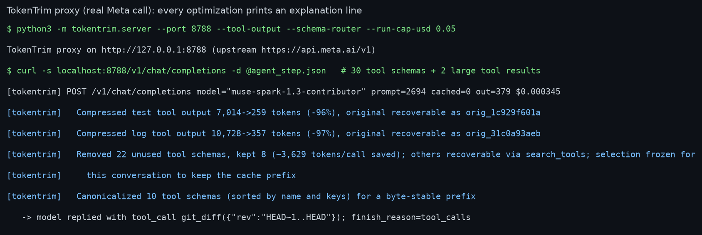
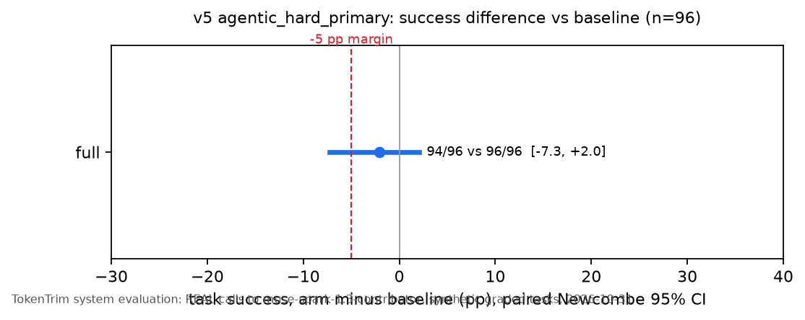
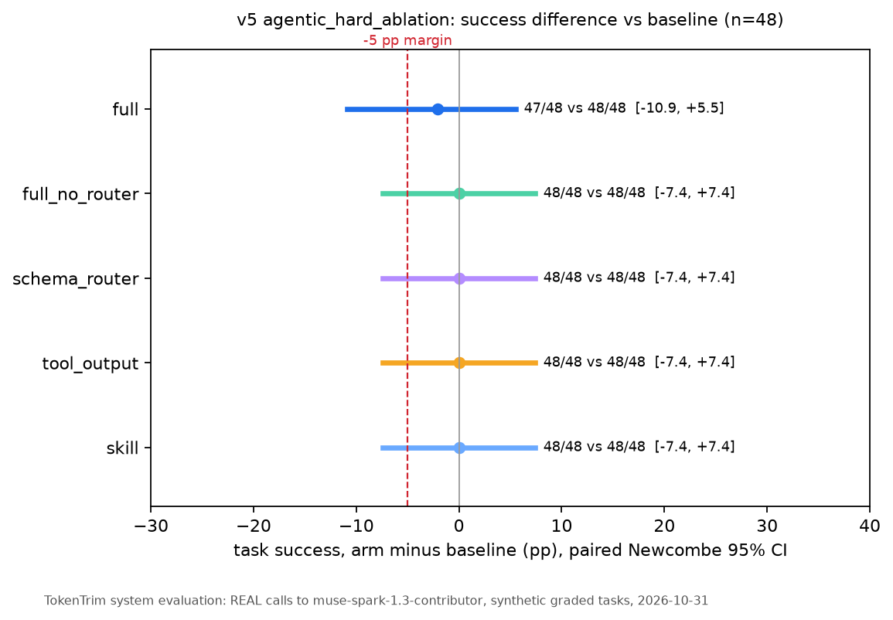
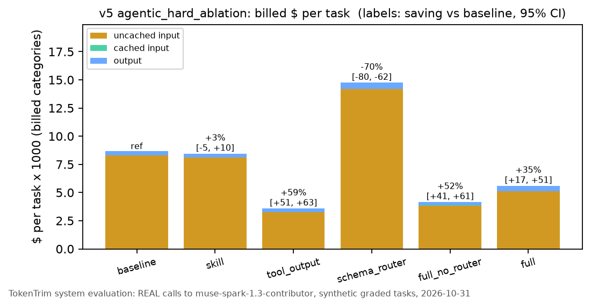
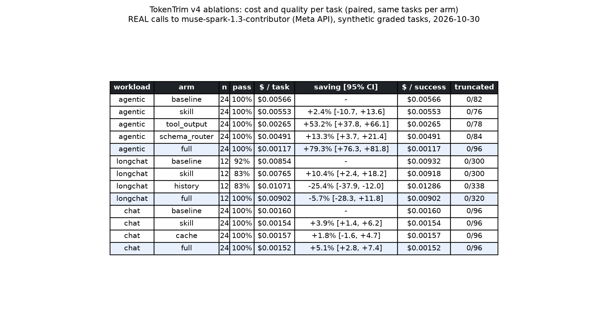
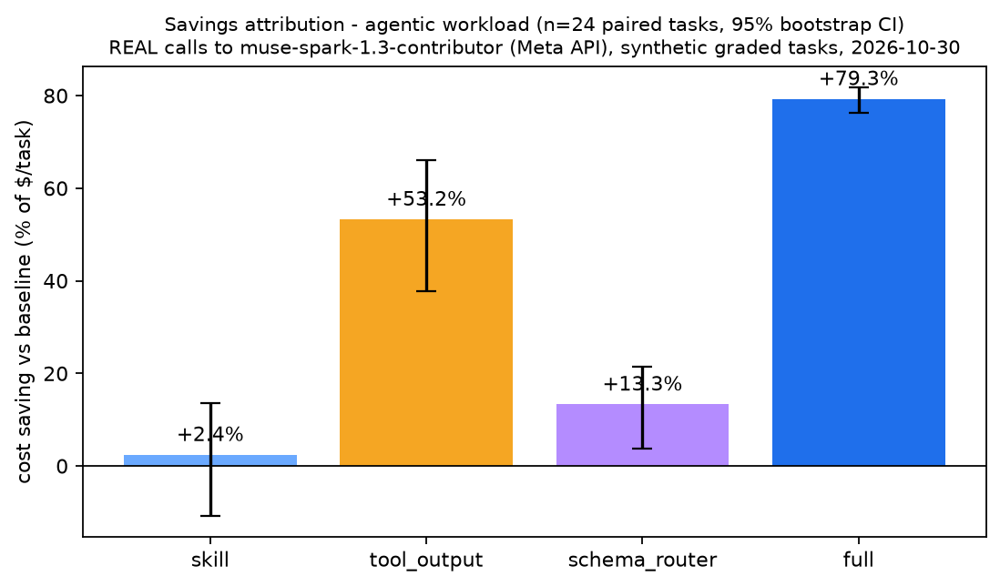
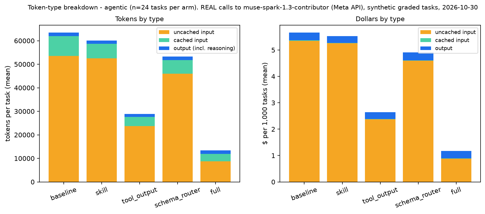
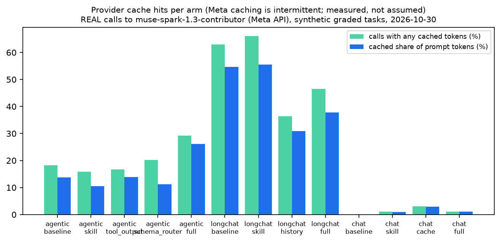
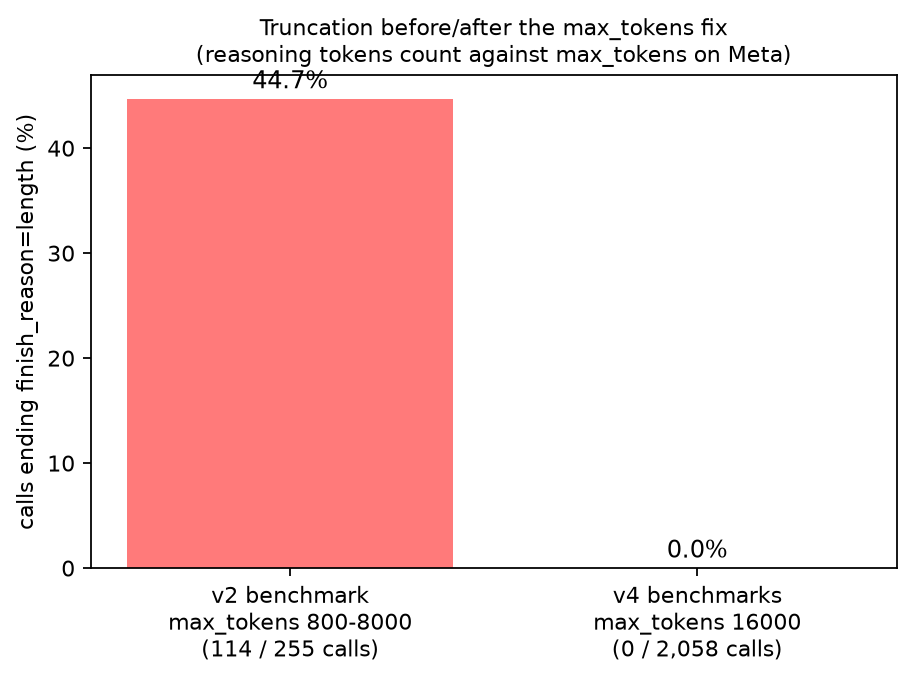
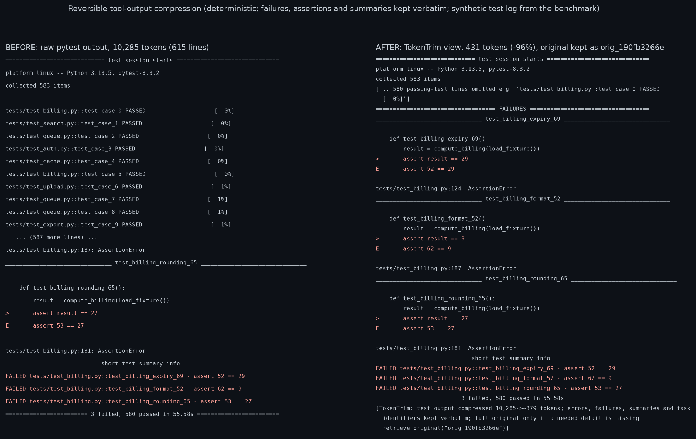

# TokenTrim

Open-source, **skill-first** token optimization for coding and tool-using agents on the Meta Model API. The
objective is the **minimum cost per successful task**, measured in billed dollars (cached input is billed at 2% of
input on Muse Spark Contributor), not the minimum token count.

> **Contributor-mode disclosure.** All real measurements below use `muse-spark-1.3-contributor`. On the Contributor
> tier **Meta may use request content for training.** The owner consented; every benchmark task is synthetic.

> **What the numbers are.** Every result in this README is a **TokenTrim system evaluation**: the same Meta model,
> called with and without TokenTrim's modules, on identical synthetic tasks. It measures TokenTrim, not any model, and
> it makes no comparison between model providers. The cheap Claude/Codex CLI probes only check task sets and graders
> before Meta money is spent. They are never a gateway upstream, and their scores are not a model ranking.

> **Local proxy only.** The gateway is a local process. It binds to `127.0.0.1` by default and calls the Meta API
> with the operator's own key from the environment, which is never logged. This project has no shared or hosted
> gateway, and no one else's traffic or keys go through it.

## Three layers, every module opt-in

| Layer | What | Needs | Where |
|---|---|---|---|
| **L1 Skill** | `SKILL.md` with a 6-rung decision ladder (avoid the call, reuse the cache, ask for less, shrink tool output but keep the evidence, summarize stale history, optimize only when it pays) plus a "never trade away" list. Progressive disclosure: references and scripts load only when needed. | nothing (no key, no proxy) | `skills/tokentrim/` |
| **L2 Hooks** | pipe compressor for command output (`cmd \| python3 -m tokentrim.hooks.compress`, original recoverable), Claude Code loop-guard hook, one-command installer for `.agents/skills`, `.claude/skills` and Codex (project or home) | a supported agent | `tokentrim/hooks/` |
| **L3 Gateway** | OpenAI Chat Completions + Anthropic Messages proxy: cache-stable prefix, reversible tool-output compression, BM25 tool-schema routing with `search_tools` recovery, optional history compaction, exact per-category accounting, **reserving spend ledger** (worst case reserved before each call, across threads/processes/retries) | direct API calls | `tokentrim/gateway.py`, `server.py`, `ledger.py` |

```sh
python3 -m tokentrim.hooks.install --project .          # copy the skill into ./.agents/skills and ./.claude/skills
python3 -m tokentrim.hooks.install --project . --with-hooks   # + Claude Code loop-guard hook (settings.json backed up)
set -a; . ~/.config/meta/env; set +a                    # META_API_KEY, never printed
python3 -m tokentrim.server --port 8787 --tool-output --schema-router --run-cap-usd 1
#   OpenAI clients:    base_url=http://127.0.0.1:8787/v1
#   Claude Code etc.:  ANTHROPIC_BASE_URL=http://127.0.0.1:8787   (/v1/messages; model ids map to the Meta model)
```

Every optimization the gateway applies prints an explanation line (real call, 2026-10-30):



## TokenTrim system evaluation, v5 (2026-10-31, pre-registered, harder tasks)

The task set, the 5 percentage-point non-inferiority margin and the analysis plan were fixed in
[`benchmarks/PREREGISTRATION_v5.md`](benchmarks/PREREGISTRATION_v5.md) before any v5 API call. One amendment was made
before the runs: the grader ignores a trailing period (issue 66). Code was frozen for the round.

**Task set.** `benchmarks/workloads_hard.py` has 96 synthetic incident tasks (ah00-ah95), 32 tool schemas, and a
~15k-token CI log per task.
- The real exception sits at 70-90% of the log, behind two decoy tracebacks.
- The answer needs three dependent tool calls: log -> `inspect_spans(trace_ref)` -> `open_artifact_manifest(release)`.
- The prompt is written so that the BM25 router deliberately **misses** both chain tools, so the model has to call
  `search_tools`.
- The compressed log hides the trace ref in 94 of 96 tasks, so the model has to call `retrieve_original`.
- **Grading:** a task passes only if all 10 checks pass: 6 exact facts, the 3 dependent calls with the right
  arguments, and no side-effect tools.
- **Statistics:** paired Newcombe 95% CI on success; paired bootstrap on $.

**Checks before any Meta spend.**
- The deterministic mock upstream: the oracle policy passes every arm, and the lazy and guess policies fail.
- The cheap CLI probes, which are not gateway runs
  ([summary](results/v5_2026-10-31/cheap_probe_hard_summary.md)):

| CLI model | raw | compressed |
|---|---|---|
| claude-haiku-5-5 | 23/24 | 24/24 |
| gpt-6-luna | 23/24 | 20/24 |

The 4 failed luna episodes passed 4/4 when re-run (issue 67). Neither difference is significant.

**Primary, H1: Full vs Baseline, 96 paired tasks** (`results/v5_2026-10-31/summary_agentic_hard_primary.json`):

| arm | pass | $/task | saving vs baseline [95% CI] | success diff [95% CI] |
|---|---|---|---|---|
| baseline | 96/96 | $0.00862 | - | - |
| full (skill + cache prefix + compression + router) | 94/96 | $0.00554 | +35.8% [+20.7, +47.7] | -2.1 pp [-7.3, +2.0] |

**Non-inferiority is NOT shown.** The lower bound of -7.3 pp does not clear the pre-registered -5 pp margin. The
interval does not show Full is worse either, because it includes 0. Both Full failures are documented:
- ah50 (issue 68): the model passed the request id to `inspect_spans`. It then looped through 37 `search_tools`
  calls that each returned "none new", and ran out of turns. That run alone cost $0.043.
- ah43 (issue 69): the model read the wrong release from the tabularized span JSON. The right value was present.



**Ablations, tasks 0-47, 48 paired tasks** (`summary_agentic_hard_ablation.json`):

| arm | pass | $/task | saving vs baseline [95% CI] | success diff [95% CI] |
|---|---|---|---|---|
| baseline | 48/48 | $0.00868 | - | - |
| skill only | 48/48 | $0.00846 | +2.5% [-4.9, +9.6] (n.s.) | 0 [-7.4, +7.4] |
| tool-output compression only | 48/48 | $0.00360 | **+58.6% [+51.2, +63.2]** | 0 [-7.4, +7.4] |
| schema router only | 48/48 | $0.01475 | **-70.0% [-80.1, -61.6] (costs more)** | 0 [-7.4, +7.4] |
| full without router (skill + cache prefix + compression) | 48/48 | $0.00417 | +52.0% [+41.0, +60.7] | 0 [-7.4, +7.4] |
| full | 47/48 | $0.00561 | +35.4% [+16.9, +50.7] | -2.1 pp [-10.9, +5.5] |




What v5 shows:
- **Tool-output compression carries the savings.** It cut prompt tokens from 96.9k to 41.0k per task.
  - The recovery path was used on every compression task: 48 greps and 1 full retrieve in 48 tasks.
  - It had no failures in 48 tasks, but 48/48 vs 48/48 only bounds the loss at 7.4 pp.
- **Negative finding: the schema router costs money when it misses.** This set is built so that it always misses.
  - Router-only made 123 `search_tools` calls and 314 vs 192 model calls, and only 3% of calls hit the cache.
    The cause is that the tool list changes mid-conversation and breaks the prefix.
  - Adding the router to compression made Full more expensive than Full without router: $0.00561 vs $0.00417 on
    the same 48 tasks. Both Full failures happened in router-enabled runs.
  - The v4 agentic set, where the router selects well, showed +13% for the router alone. Whether the router pays
    off depends on how well it selects.
  - Recommendation from these data: turn the router on only when its recall on the agent's real prompts is high.
    Its cost on a miss is now measured.
- **Skill only:** no significant dollar effect where uncached input dominates. This is the same as in v4.
- **Truncation:** 0 calls ended with `finish_reason=length` in v5 (`max_tokens` 16,000).
- **Not shown:** that any arm is equal to baseline within 5 pp. That needs more failures observed, or more tasks.

LONGCHAT_V5_PLACEHOLDER

## TokenTrim system evaluation, v4 (2026-10-30)

`benchmarks/` runs paired arms on **identical synthetic tasks** with a unique session tag per (task, arm), arm order
randomized and interleaved per task, 2 warm-up calls excluded, `max_tokens` 16,000, and paired bootstrap 95% CIs
(2,000 resamples). All calls are REAL Meta API calls priced from the returned `usage`. "Saving" = reduction in mean
$ per task vs baseline. "Full" = skill + gateway modules of that workload (hooks share the same optimizer code and
are tested offline). Raw rows and summaries: `results/v4_2026-10-30/{agentic,longchat,chat}/`.



| workload (n paired) | arm | pass | $/task | saving vs baseline [95% CI] |
|---|---|---|---|---|
| agentic incident triage, 30 tool schemas, large tool outputs (24) | baseline | 24/24 | $0.00566 | - |
| | skill only | 24/24 | $0.00553 | +2.4% [-10.7, +13.6] (not significant) |
| | tool-output compression only | 24/24 | $0.00265 | +53.2% [+37.8, +66.1] |
| | schema router only | 24/24 | $0.00491 | +13.3% [+3.7, +21.4] |
| | **full** (skill + cache prefix + compression + router) | 24/24 | **$0.00117** | **+79.3% [+76.3, +81.8]** |
| long conversation, 24 user turns + graded recall (12) | baseline | 11/12 | $0.00854 | - |
| | skill only | 10/12 | $0.00765 | +10.4% [+2.4, +18.2] |
| | history compaction only | 10/12 | $0.01071 | **-25.4% [-37.9, -12.0] (costs more)** |
| | full (skill + cache prefix + history) | 12/12 | $0.00902 | -5.7% [-28.3, +11.8] |
| plain chat, 4 graded questions over a 2.5k-token doc (24) | baseline (timestamp + request id in system prompt) | 24/24 | $0.00160 | - |
| | skill only | 24/24 | $0.00154 | +3.9% [+1.4, +6.2] |
| | cache prefix only | 24/24 | $0.00157 | +1.8% [-1.6, +4.7] (not significant) |
| | full (skill + cache prefix) | 24/24 | $0.00152 | +5.1% [+2.8, +7.4] |

What this does and does not show:
- **Where the money is:** in the agentic workload, uncached input is 94% of baseline spend
  (53.5k uncached / 8.5k cached / 1.5k output tokens per task). Compression and schema routing attack exactly that;
  Full cuts uncached input to 8.8k tokens per task. Recovery paths were used, not just offered: 8 full
  `retrieve_original` calls (compression-only arm) and 17 targeted greps (Full arm).
- **Skill only** reduces output/reasoning tokens (chat -30% output tokens, median session latency 41.8 s -> 29.6 s;
  long conversation -25% output tokens), at the price of ~500 extra input tokens per call. Its dollar effect is small
  where input dominates.
- **Negative finding:** history compaction **raised** cost by 25% on long conversations, because Meta's cache
  already covered 55% of prompt tokens there and compaction breaks it, adds a model call, and the model fetched the
  compacted transcript back in about a third of conversations (issue 63). It stays **off** by default.
- **Negative finding:** removing volatile prompt lines barely mattered in plain chat (cache hits 0% -> 3% of calls);
  Meta's cache is intermittent for short prefixes (issues 46, 64).
- **Quality:** no observed loss in agentic or chat (24/24 in every arm). That is a **ceiling effect, not a
  non-inferiority proof**: with 24/24 vs 24/24 the 95% interval of the pass-rate difference is about +-14 points
  (issue 62). Long-conversation pass counts (10-12 of 12) are too small to compare.
- **Post-hoc correction (v5, issue 66):** every v4 long-conversation failure was the same grader artifact. The
  model answered "Blue Plate Co." and the expected value was "Blue Plate Co"; the only difference is the trailing
  period. Re-graded with the fixed grader, every long-conversation arm is 12/12. So the 10/12 for skill only was
  not a skill effect. The table keeps the counts as originally graded.
- **Note on Full (agentic):** it ran before the issue 65 fix, which replays internal `retrieve_original` /
  `search_tools` rounds into later turns. The v5 runs use the fix.
- **Truncation:** 0 of 2,058 benchmark calls ended `finish_reason=length` (`max_tokens` 16,000), vs 114 of 255 in the
  v2 run, where reasoning tokens exhausted `max_tokens` (issue 47).
- Workloads are synthetic and generated deterministically (`benchmarks/workloads.py`); they were tuned once on small
  pilots (issue 58) and then frozen before the reported runs. Latency numbers include periods when the API slowed
  down under concurrent runs.







**Recommended defaults from these data:** skill on; gateway cache prefix on; tool-output compression and schema
router on for tool-heavy agents; history compaction off; lean-skill injection off (the skill covers it).

Cheap-model checks before any Meta spend (`benchmarks/cheap_probe.py`, `claude-haiku-5-5` via the Claude Code CLI on
the owner's subscription, no API key): the first compressor scored 5/6 vs 6/6 raw, which led to query-aware
protection (issue 57); the fixed compressor then scored 4/4 on re-probed tasks; the skill kept 6/6 chat answers correct. Total Meta spend for all of v4 (smoke tests, pilots, benchmarks): **$1.35** of a $12 cap.

## Earlier versions (v2/v3, superseded by v4)

The sections below describe the v3 middleware (cache-aware layout + eager prune) and its measurements. They are kept
for the record.

### v3 overview

Open-source middleware that cuts what coding agents spend on the Meta Model API. TokenTrim optimizes **billed dollars, not tokens**: cached input is a subset of input and is billed at its own, much lower rate (2% of input on Muse Spark Contributor, 12% on Spark Standard), so what matters is whether the provider's prefix cache can hit.

**TokenTrim = cache-aware layout + eager prune + a measurement harness.**

- **cache_layout** keeps the request prefix byte-stable even when the client is sloppy: name-sorted, key-sorted tool JSON, stable segments first, and volatile lines (timestamps, UUIDs, request ids) taken out of the system prompt (`volatile_policy="move"` to a trailing message, or `"drop"`). On Meta's real cache only `drop` restored hits (v3b below).
- **eager prune** drops stale and unreferenced reads as soon as they go stale, and latches each drop so the prefix never oscillates.
- **measurement harness** runs a real paired benchmark on the live API with hard spend caps: billed $ from the API `usage` fields, real pass/fail from task tests, Wilson and paired-bootstrap intervals, record and replay.

Optional, not in the headline: **trim** (log compaction; it compacted nothing on the benchmark's short real logs) and **route** (cheap-first with escalation; the 3-task pilot never escalated, see below).

> **Status: prototype with real measurements.** `results/real_meta_2026-10-30_v3/` is the current REAL run (20 tasks × 4 modes × 3 repeats, a 2-mode layout-only follow-up, and a 3-task route pilot). `results/real_meta_2026-10-30/` is the first, smaller real run, whose naive baseline is superseded. Everything else under `results/` is **FAKE or SIMULATION data**.

## Real results (v3, 2026-10-30)

Model `muse-spark-1.3-contributor` on `https://api.meta.ai/v1`. **Contributor tier: Meta may use request content for training.** The owner consented, and the tasks are synthetic. 20 tasks (every 2nd of the 40, `--tasks stride:2`) × 4 modes × 3 repeats = 240 runs, all complete, none skipped. Billed $1.98 under a shared, file-locked spend ledger with a hard $15 cap for the whole v3 effort. Dollars come from the API `usage` fields priced at list price. Full tables: [`summary.md`](results/real_meta_2026-10-30_v3/summary.md).

**Realistic naive clients** (they replace v2's strawman that reshuffled tool JSON on every call):
- `baseline`: a well-behaved client (name-sorted tools, no volatile text).
- `baseline-ts`: a volatile `Current time` plus `request_id` line near the top of the system prompt.
- `baseline-tools`: the tool list in set order with dict-order nondeterminism. The order is re-drawn only when the agent adds or removes a tool (turns 4 and 7).
- `tokentrim`: the naive client (timestamp plus set-ordered tools) run through TokenTrim's defaults.

| Mode | Runs | Pass, run-level [Wilson 95%] | Pass, task-level n=20 [Wilson 95%] | Mean $/run | Prompt tok/run | Calls with a cache hit |
|---|---:|---:|---:|---:|---:|---:|
| baseline | 60 | 100% [94.0, 100] | 100% [83.9, 100] | 0.00802 | 78,421 | 12% |
| baseline-ts | 60 | 100% [94.0, 100] | 100% [83.9, 100] | 0.00906 | 79,619 | 0% |
| baseline-tools | 60 | 100% [94.0, 100] | 100% [83.9, 100] | 0.00822 | 79,118 | 12% |
| tokentrim | 60 | 100% [94.0, 100] | 100% [83.9, 100] | 0.00766 | 68,235 | 5% |

Paired comparisons: repeats are averaged per task, then a paired bootstrap runs over the 20 tasks (2,000 resamples, seed 42). Saving is positive when the first mode is cheaper.

| Comparison | Billed $ saving [95% CI] | Prompt-token saving [95% CI] | Pass diff, Newcombe [95% CI] |
|---|---:|---:|---:|
| tokentrim vs baseline-ts | **15.5%** [14.0, 17.0] | 14.3% [13.4, 15.2] | 0 pp [−16.1, +16.1] |
| tokentrim vs baseline-tools | **6.8%** [3.2, 10.7] | 13.8% [12.6, 15.1] | 0 pp [−16.1, +16.1] |
| tokentrim vs baseline (clean client) | **4.5%** [2.2, 6.6] | 13.0% [12.3, 13.7] | 0 pp [−16.1, +16.1] |
| baseline-ts vs baseline (cost of a timestamp) | −13.0% [−15.4, −10.7] | −1.5% | 0 pp |
| baseline-tools vs baseline (cost of set-ordered tools) | −2.5% [−6.5, +1.2] (not significant) | −0.9% | 0 pp |

What this does and does not show:
- **A volatile timestamp is the costly cache-buster.** It removed every cache hit and added 13% to the bill. Set-ordered tools cost little (−2.5%, and the interval includes 0), because the order only changes when the tool set changes, which breaks even a clean client's cache.
- **Most of TokenTrim's saving here is eager prune.** It cut 13–14% of prompt tokens. TokenTrim's calls hit the cache *less* often (5%) than the clean baseline (12%). Hoisting volatile lines into a trailing message did not restore real Meta cache hits, although it does in the offline mock. Real hits seem to require the new prompt to extend the previous prompt, and a trailing metadata message breaks that. The layout-only follow-up below confirms it.
- **Pass rate: 240/240 runs passed in every mode**, and the eager-prune pass-rate guard flagged no task. With 20 tasks the task-level difference interval is [−16.1, +16.1] pp. That is wider than the −10 pp margin, so **non-inferiority is not claimed**. The bootstrap pass interval is degenerate ([0, 0]) because every run passed. The tasks are too easy to discriminate.
- 91% of completion tokens were hidden reasoning, and 835 of 1,930 calls ended with `length` at the harness's `max_tokens` (issue 47).

**Layout-only follow-up (v3b, $1.02, 120 runs, same 20 tasks × 3 repeats, run right after the main run).** These runs use cache_layout alone, with no prune, on the same naive client:

| Mode | Mean $/run | Calls with a cache hit | Billed $ vs baseline-ts [95% CI] | Billed $ vs clean baseline [95% CI] |
|---|---:|---:|---:|---:|
| layout-move (default: volatile lines moved to a trailing message) | 0.00885 | 3% | 2.3% cheaper [0.3, 4.5] | 10.4% dearer [7.6, 13.5] |
| layout-drop (`volatile_policy="drop"`) | 0.00814 | 12% | **10.1% cheaper** [7.9, 12.4] | 1.6% dearer [−1.9, +5.0], not significant |

- **Moving the timestamp to the end does not restore Meta's cache; dropping it does,** back to the clean client's level. Real hits appear to require each request to extend the previous one, and a trailing metadata message breaks that. The offline mock matches any common prefix, so it did not show this. This is issue 55.
- `tokentrim vs layout-move`: 13.5% cheaper [11.8, 15.4], with 14.1% fewer prompt tokens. That is roughly the prune effect, measured across two invocations. No prune-only mode was run.
- The default is still the lossless `move`, so the `tokentrim` numbers above describe the shipped defaults. Switching to `drop`, or to an append-only placement, is an open decision; the combination with eager prune has not been measured.

**Route pilot** (3 tasks, 1 pass each, $1.24, sub-cap $3): Wonder alone vs Spark-first (Standard `muse-spark-1.3` with all savers, sticky escalation to Wonder).

| Task | Wonder only | Spark-first |
|---|---:|---:|
| t07_interval_union (easy) | $0.2988 ✓ | $0.0952 ✓ |
| t15_dependency_order (hard) | $0.2986 ✓ | $0.0913 ✓ |
| t21_json_merge_patch (medium) | $0.3564 ✓ | $0.1014 ✓ |
| total | $0.954, 3/3 | $0.288, 3/3 (−70%) |

Spark-first **never escalated**, so the escalation path is untested on the real API. The −70% mostly reflects the price gap between Spark and Wonder, mixed with prune and layout effects. With 3 tasks, routing stays **out of the headline** (issue 54). The $30 like-for-like route test was not run.

**Trim** is optional and was checked offline on real logs ($0, [`trim_long_log_check.json`](results/real_meta_2026-10-30_v3/trim_long_log_check.json)). A 72-line passing unittest log went from 1,897 to 100 tokens. A 47-line failing log went from 675 to 517, with every error line kept. The benchmark's logs are short, so trim did no work in the runs above, and no end-to-end API saving is claimed.

**Not measured:** other models or tiers for the main comparison; real third-party agents (the agent is scripted); a prune-only mode.

## What it does

Each saver runs inside a fail-open wrapper. If any saver raises, the original request goes to the strong model unchanged (`SpendCapExceeded` is the one exception and always propagates).

| Saver | Module | Default | Cache-aware rule |
|---|---|---|---|
| **cache_layout** | `tokentrim/layout.py`, `planner.py` | on | Stable kinds (system, tool schemas, repo map, pinned files) first; tool JSON serialized with sorted keys and tool lists sorted by `name`; `hoist_volatile_lines` moves timestamp/UUID/request-id lines out of stable segments into one trailing message (content kept verbatim); cache-buster lint. Conversation order is never reshuffled. `AppendOnlyHistory` refuses rewrites without an approved `CompactionCheckpoint`. |
| **prune** | `tokentrim/pruner.py`, `middleware.py` | on, **eager** | Unreferenced and stale items are dropped as soon as the pruner selects them; drops are latched. The dollar break-even gate is opt-in (`prune_checkpoints=True`): on the real API it deferred every drop because it assumes a reliable cache (issue 52). Benchmarks flag any task where TokenTrim passes less often than the baseline. |
| **trim** (optional) | `tokentrim/compaction.py` | on | Compacts test/build logs over 40 lines at ingest (keeps every error/traceback/FAILED line), deterministically so history stays byte-stable; full output restorable by ID in `OutputStore`. |
| **route** (optional) | `tokentrim/router.py`, `routing.py` | on when two models are configured | Cheap model for routine steps, sticky escalation to the strong model on visible signals. A downgrade must pass `cache_aware_switch`, because provider caches are per model. |

Supporting pieces:
- `tokentrim/cost.py` `CostModel`: per-model input, cached input, output and optional `cache_write` prices, with overrides, a price hash and break-even maths.
- `tokentrim/guard.py` `SpendGuard` (per-task, global persisted ledger, step caps; worst-case projection before each call) and `bench/real_common.py` `SharedLedger` (thread- and process-safe ledger with reservations, used by the real benchmark).
- `tokentrim/proxy.py`: a loopback-only OpenAI-compatible `/v1/chat/completions` proxy (see below).
- `tokentrim/clients/meta.py`: OpenAI-compatible client for the Meta Model API (`https://api.meta.ai/v1` by default; base URL configurable). Key from `TOKENTRIM_UPSTREAM_API_KEY`, `META_API_KEY` or `MODEL_API_KEY`; never logged. Parses `prompt_tokens`, `cached_tokens`, `completion_tokens` (incl. reasoning). Tests never call the network.
- `tokentrim/clients/mock.py`: `MockProviderClient` (offline per-model prefix-cache SIMULATION) and JSONL record/replay helpers.

## Proxy (loopback, OpenAI-compatible)

```sh
set -a; . ~/.config/meta/env; set +a          # provides META_API_KEY; never printed
python3 -m tokentrim.proxy --port 8787 --upstream-base-url https://api.meta.ai/v1 \
    --default-model meta/muse-spark-1.3-contributor --ledger results/proxy_ledger.json --global-cap-usd 1
# any OpenAI client:  OpenAI(base_url="http://127.0.0.1:8787/v1", api_key="unused")
```

A live smoke call on 2026-10-30 worked with curl and with the official `openai` Python client against the real Meta API ([`proxy_smoke.md`](results/real_meta_2026-10-30_v3/proxy_smoke.md)).
- **This v3 proxy** (`tokentrim/proxy.py`) handles plain-text chat completions only. It rejects `tools` and
  `stream: true` with HTTP 400 (issue 51).
- **The v4 gateway server** (`tokentrim.server`, quickstart at the top) accepts tools, buffered streaming, and the
  Anthropic `/v1/messages` front-end.
- **Both** are local, loopback-only processes. They use the operator's own upstream key and ignore the client's
  `Authorization` header. There is no shared gateway.

## Works with other agents (v3 notes; v4 added `/v1/messages`, tools and buffered streaming)

TokenTrim's savers are provider-agnostic; only the transport is OpenAI-chat-shaped today. The proxy's upstream is configurable (`--upstream-base-url` or `TOKENTRIM_UPSTREAM_BASE_URL`, HTTPS or loopback HTTP), so any OpenAI-compatible endpoint can sit behind it. Planned, not built:
- an **Anthropic Messages** front-end (`/v1/messages`, with `cache_control` breakpoints) so Claude Code can point `ANTHROPIC_BASE_URL` at TokenTrim;
- an **OpenAI Responses** front-end (`/v1/responses`) for Codex;
- tool-call and streaming pass-through, which both need.

## Replay mode (for demos)

Every v3 call was recorded (`results/real_meta_2026-10-30_v3/recording_*.jsonl`: model, response text, billed usage; no keys, no request bodies). Replay re-runs the same harness offline with the **recorded** responses and usage, and re-checks the recorded edits with the real test checker:

```sh
python3 -m bench.real_meta --replay results/real_meta_2026-10-30_v3/recording_main.jsonl \
    --tasks t07_interval_union --modes baseline-ts,tokentrim --repeats 1 --tag demo --out /tmp/tt_replay
```

A replay is **not a live run**: it makes no API calls, and its output is labelled `REPLAY of recorded REAL run`. Timestamps in the replayed prompts are regenerated and do not affect the replayed usage.

## Quickstart (offline, standard library only, Python 3.13)

```sh
python3 -m unittest discover -s tests -v        # TOKENTRIM_SKIP_REFERENCE_TEST=1 skips the 80 slow reference checks
python3 -m bench.real_meta --dry-run --workers 1 --tasks first:2 --out /tmp/tt_dry   # offline mock, no API calls
python3 -m bench.simulate --tasks bench/tasks/tasks_40.jsonl --repeats 3 --seed 42 --out results/sim/ --sweep
python3 -m bench.runner --reference-self-test                      # reference solutions pass the real checker
```

Real run (spends money; capped):

```sh
set -a; . ~/.config/meta/env; set +a
python3 -m bench.real_meta --tasks stride:2 --modes baseline,baseline-ts,baseline-tools,tokentrim --repeats 3 \
    --workers 8 --cap-usd 15 --run-cap-usd 11 --record results/real_meta_2026-10-30_v3/recording_main.jsonl
python3 -m bench.real_report_v3
```

## Simulation harness (`bench/simulate.py`) — SIMULATION, not measurements

The harness runs a scripted agent on each of the 40 tasks: list → read files → grep → read distractors → run tests → plan → edit+test attempts (up to 4) → summary. Calls go through `TokenTrim` and `MockProviderClient`.

- **Prices.** It uses the verified Meta Muse prices: `meta/muse-spark-1.3` is the cheap model and `meta/muse-wonder-1.0` the strong one. An Anthropic-style 1.25× cache-write profile is included for illustration only.
- **Pass outcomes.** These are *assumed* per-tier probabilities drawn with common random numbers, so every mode sees identical draws. No task code is executed. Trimming's effect on quality is an explicit `trim_penalty` assumption, which defaults to 0.
- **Context sizes.** The `realistic` scenario pads the system prompt, the tools and the file reads to agent-sized contexts with synthetic, labelled content. The `toy` scenario uses the corpus as-is.
- **Statistics.** Repeats are averaged within each task, then a paired percentile bootstrap runs over the 40 tasks. Non-inferiority means the lower 95% CI bound of the pass-rate difference is above −10 pp.
- **Modes.**
  - `baseline`: Wonder only, with a cache-friendly layout.
  - `tokentrim`: all savers with the heuristic router.
  - `tokentrim-cheapfirst`: all savers with cheap-first routing and escalation.
  - Ablations: `prune-only`, `prune-eager` (no break-even gate), `trim-only`, `route-only`, `route-percall` (no switch check), `route-cheapfirst`, `cheap-only`.
  - Cache-busting comparisons (tool JSON re-serialized with random key order on every call): `baseline-naive`, `cache-only-naive`, `tokentrim-naive`.

Latest run (2026-10-28, seed 42, 40 tasks × 3 repeats, `realistic`; prune pinned to the v2 *gated* default, see issue 52). Full table: [`results/sim/sim_summary.md`](results/sim/sim_summary.md).

| SIMULATION mode | $/task | Saving vs reference [95% CI] | Pass-rate diff pp [95% CI] | Non-inferior |
|---|---:|---:|---:|:-:|
| baseline (Wonder only) | 0.155 | — | — (98.3%) | — |
| tokentrim (heuristic router) | 0.137 | 11.9% [10.6, 13.3] | −1.7 [−4.2, 0.0] | yes |
| tokentrim-cheapfirst | 0.084 | 45.6% [40.1, 51.1] | −4.2 [−9.2, 0.0] | yes (marginal) |
| trim-only | 0.137 | 11.6% [10.9, 12.3] | 0.0 | yes |
| prune-eager (no break-even gate) | 0.176 | **−13.6%** [−14.0, −13.3] | 0.0 | yes |
| route-only (heuristic) | 0.153 | 1.7% [0.4, 3.1] | −1.7 [−4.2, 0.0] | yes |
| cheap-only (Spark only) | 0.061 | 60.8% [59.6, 61.9] | −10.8 [−17.5, −4.2] | **no** |
| cache-only-naive vs baseline-naive | 0.155 vs 0.541 | 71.3% [71.1, 71.5] | 0.0 | yes |

How to read these numbers:
- They are simulated. Prices are real list prices, but traces and pass outcomes are synthetic.
- The cache-busting comparison shows what layout hygiene is worth when a client really does bust its cache. It is not a claim about any particular agent.
- See [`RESEARCH_2026-10-28.md`](RESEARCH_2026-10-28.md) for the design rationale and [`issues-found/`](issues-found/README.md) for known gaps.

## First real run (v2, 2026-10-30 afternoon) — superseded

Kept for the record. Its `*-naive` rows used a **strawman** client that re-shuffled tool JSON on every call (issue 50); v3 above replaces it. `bench/real_meta.py` drives the same scripted agent against the live API with real JSON edits checked by the task tests; `bench/meta_cache_probe.py` probes the cache. Model `muse-spark-1.3-contributor`, 6 tasks (t01, t07, t13, t21, t28, t37), one pass each, $0.3166 total under a $0.50 SpendGuard cap. Full tables: [`results/real_meta_2026-10-30/summary.md`](results/real_meta_2026-10-30/summary.md).

| REAL comparison (6 tasks, 1 pass) | Prompt tokens | Billed $ | $ if no cache hits | Pass |
|---|---:|---:|---:|:-:|
| tokentrim (all savers, default gates) vs baseline | −2.7% | −9.7% | −5.1% | 6/6 vs 6/6 |
| tokentrim-eager (prune without break-even gate) vs baseline | **−15.7%** | −13.6% | −15.7% | 6/6 vs 6/6 |
| tokentrim-naive vs baseline-naive (cache_layout fixes shuffled tool JSON) | −0.1% | **−26.9%** | +0.7% | 6/6 vs 6/6 |
| baseline-naive vs baseline (cost of busting the cache) | −2.8% | +30.1% | −4.3% | 6/6 vs 6/6 |

Real vs simulated:
- **cache_layout** is the one saver that clearly paid off: 0 cached tokens with shuffled tool JSON vs 147k cached with TokenTrim's stable layout. The real saving (27%) is well below the simulated 71% because real Meta cache hits are intermittent: only ~31% of calls hit ([issue 46](issues-found/46-meta-cache-hits-intermittent.md)).
- **prune** with the default break-even gate deferred every drop, because the gate assumes a reliable cache. Eager pruning cut 15.7% of prompt tokens with no pass-rate loss on this tiny sample; the simulation predicted eager pruning would *cost* 13.6% more.
- **trim** compacted nothing: real test logs on these repos are short. The simulated 11.6% came from synthetic long logs ([issue 48](issues-found/48-trim-route-real-run-gaps.md)).
- **route** is a no-op with one model. The one Standard-vs-routed check is not like-for-like (the Standard baseline hit the per-task cap).
- 91% of completion tokens were hidden reasoning; short `max_tokens` truncates replies ([issue 47](issues-found/47-reasoning-tokens-and-max-tokens.md)).

These are single-pass observations on six small tasks, not statistically meaningful estimates.

## Prices

USD per one million tokens, in `tokentrim/prices.toml`. The Meta rows match the public dev.meta.ai pricing page (checked 2026-10-28) but have not yet been checked against a bill.

| Model | Input | Cached input | Output |
|---|---:|---:|---:|
| meta/muse-spark-1.3 | 1.25 | 0.15 | 4.25 |
| meta/muse-wonder-1.0 | 4.00 | 0.20 | 20.00 |
| meta/muse-spark-1.3-contributor | 0.10 | 0.002 | 0.20 |
| fake/cheap (synthetic) | 1.00 | 0.10 | 2.00 |
| fake/strong (synthetic) | 4.00 | 0.20 | 20.00 |

- Contributor mode lets Meta train on content, is not offered for Wonder, and is never selected unless `allow_contributor=True` is passed.
- The page states no minimum cacheable prefix, TTL or cache-write charge. These must be measured.
- Override the price table with `TOKENTRIM_PRICES=path.toml` or `CostModel(overrides=...)`.
- Cost formula: `((input − cached − write) × input + cached × cached_input + write × cache_write + output × output) / 1e6`.

## FAKE benchmark runner and real checker (`bench/runner.py`)

The older harness uses a deterministic FAKE client that never edits repositories. Its passing checks are not evidence of coding correctness.

```sh
python3 -m bench.runner --client fake --tasks bench/tasks/tasks_40.jsonl --out results/results_40_fake.json
python3 -m bench.runner --checker real --tasks bench/tasks/tasks_40.jsonl --out results/results_40_real.json
```

The real checker:
- **Input.** It applies the final response, formatted as JSON with full-file replacements: `{"files": {"core.py": "..."}}`. Paths must be canonical relative POSIX paths. Traversal, symlinks, duplicate keys and edits under `tests/` are rejected.
- **How checks run.** They run without a shell, in disposable copies, with a 5-second timeout. This is not a security sandbox, so use only trusted code.
- **Reference solutions.** These are read only by `--reference-self-test`.

The corpus has 40 tasks across 14 category/difficulty cells (`bench/tasks/tasks_40.jsonl`, repos in `bench/tasks_repo/`), plus three toy tasks in `bench/tasks/example_tasks.jsonl`. Open `dashboard/index.html` to view runner output.

## Tasks and statistics

Task files are JSON arrays or JSONL, one object per line:

```json
{"id":"example","repo":"bench/examples/add","prompt":"Fix addition.","check":"python3 -m unittest -q","files":["main.py"],"solution":"relative/path/to/overlay","category":"bugfix","difficulty":"easy"}
```

Required: `id`, `repo`, `prompt`, `check`. Optional: `files`, `solution`, `category`, `difficulty` (`easy`, `medium`, `hard`). Extra keys are ignored. Repository and solution paths are relative to the project root; file paths are relative to the task repo. The fake runner reads only listed context files, never reference solutions, and never executes `check`. The sample task records provide concrete checks for their individual toy exercises. Paths are constrained to the repository.

In `bench.runner` (FAKE client) each task receives two simulated steps (read, then edit), identical initial context, and an isolated cold client cache for each mode. Artificial irrelevant context and diagnostic output exercise pruning. `run_benchmark` accepts a `client_factory` and a checker callable `(task, responses, mode) -> bool | CheckResult`; `real_checker` applies and checks the final response. A production benchmark still needs a sandboxed editing-agent loop. Reference solutions must remain hidden from the agent.

Summaries report mean total tokens, estimated USD, and pass rate per task. Cached input is a subset of input and is not counted twice. Seeded percentile bootstrap uses 2,000 resamples by default. Paired comparisons match task IDs and resample task pairs; differences are TokenTrim minus baseline. Percent savings use the ratio of resampled means. Zero denominators produce JSON `null` for undefined relative estimates/intervals. The dashboard displays pass-rate differences in percentage points. Tiny, constant, or fake samples can have degenerate intervals; these are descriptive, not evidence of general performance. `--seed`, `--samples`, and `--budget` configure the run.

## Roadmap

1. Tool-call and streaming pass-through in the proxy, then Anthropic Messages and OpenAI Responses front-ends (Claude Code, Codex).
2. A prune-only real mode, and a harder task set where pass rates can actually differ, so a pass-rate margin can be tested.
3. A harder task set where Spark fails visibly, to test escalation routing for real before it goes into the pitch.
4. Model Muse cache hits as probabilistic in the simulator and in the (opt-in) prune break-even gate.

## License

Apache License 2.0 — see [`LICENSE`](LICENSE) and [`NOTICE`](NOTICE). Copyright 2026 Nandigam Hari Krishna.
